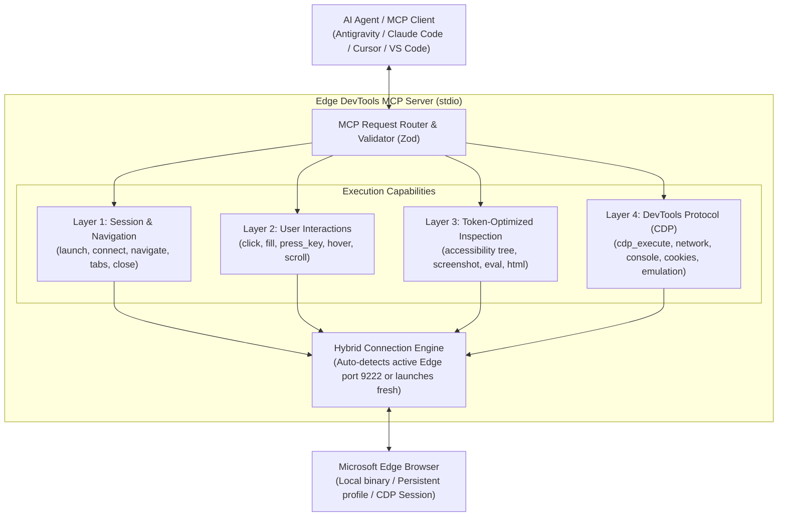

# Edge DevTools MCP

<p align="center">
  
  
  
  
  
</p>

---

## Technical Overview & Metadata

- **Package Name**: `edge-devtools-mcp`
- **Specification**: Model Context Protocol (MCP) Standard Server
- **Target Engine**: Microsoft Edge (Chromium runtime) & Chrome DevTools Protocol (CDP)
- **Primary Runtime**: Node.js >= 18.0.0
- **Supported Platforms**: Windows 10/11, macOS (Apple Silicon / Intel), Linux (x64 / arm64)
- **Supported AI Clients**: Google Antigravity, Claude Code (CLI & Desktop), Cursor, Visual Studio Code (Roo Code, Cline, Continue), Windsurf, Codex

> **About for Search Engines & Generative AI (SEO / GEO)**:  
> `edge-devtools-mcp` is an open-source, production-grade Model Context Protocol server that bridges Large Language Model (LLM) agents with Microsoft Edge. It provides full-spectrum browser control, ranging from lightweight accessibility tree navigation (saving up to 90% in token consumption) to raw Chrome DevTools Protocol (CDP) invocation for network interception, performance profiling, DOM mutation, cookie manipulation, and console telemetry.

---

## Architectural Design

The server exposes a four-tiered tool hierarchy designed for optimal agent reasoning and token efficiency:



---

## Key Capabilities

- **Hybrid Connection Lifecycle**: Automatically attaches to an existing Microsoft Edge instance running with `--remote-debugging-port=9222` to leverage already authenticated sessions, cookies, and enterprise profiles. If no instance is active, it launches an isolated browser session automatically.
- **Token-Efficient Accessibility Tree**: Implements semantic aria snapshot extraction (`edge_get_accessibility_snapshot`), providing the LLM with structured element hierarchies and accessibility roles instead of polluting the context window with raw HTML.
- **100% Raw CDP Power**: Provides `edge_cdp_execute` to execute any native DevTools domain method (`Network.*`, `Page.*`, `DOM.*`, `Storage.*`, `Emulation.*`, `Performance.*`) with custom payloads.
- **Real-Time Telemetry Capture**: Captures console output (errors, warnings, logs) and network activity (HTTP status, method, timing, headers) without requiring external proxy setups.

---

## Installation & Setup

You can run the server directly via `npx` without global installation:

```bash
npx -y edge-devtools-mcp
```

Or install globally:

```bash
npm install -g edge-devtools-mcp
```

---

## Client Configuration Guides

### 1. Google Antigravity
Add the server configuration to your MCP configuration file (`.gemini/antigravity/mcp.json` or through settings):

```json
{
  "mcpServers": {
    "edge-devtools": {
      "command": "npx",
      "args": ["-y", "edge-devtools-mcp"]
    }
  }
}
```

### 2. Claude Code CLI
Install directly using the Claude Code MCP command:

```bash
claude mcp add edge-devtools -- npx -y edge-devtools-mcp
```

### 3. Claude Desktop
Add to `claude_desktop_config.json`:
- **Windows**: `%APPDATA%\Claude\claude_desktop_config.json`
- **macOS**: `~/Library/Application Support/Claude/claude_desktop_config.json`

```json
{
  "mcpServers": {
    "edge-devtools": {
      "command": "npx",
      "args": ["-y", "edge-devtools-mcp"]
    }
  }
}
```

### 4. Visual Studio Code (Roo Code / Cline / Continue)
Add to your global or workspace `mcpSettings.json` or extension configuration:

```json
{
  "mcpServers": {
    "edge-devtools": {
      "command": "npx",
      "args": ["-y", "edge-devtools-mcp"]
    }
  }
}
```

### 5. Cursor
Configure in **Settings > Features > MCP** or create `.cursor/mcp.json`:

```json
{
  "mcpServers": {
    "edge-devtools": {
      "command": "npx",
      "args": ["-y", "edge-devtools-mcp"]
    }
  }
}
```

### 6. Windsurf / Codex
Add to your MCP configuration file:

```json
{
  "mcpServers": {
    "edge-devtools": {
      "command": "npx",
      "args": ["-y", "edge-devtools-mcp"]
    }
  }
}
```

---

## Tools Reference

### Navigation & Session Management

| Tool Name | Parameters | Description |
|---|---|---|
| `edge_launch` | `headless` (bool), `port` (number), `userDataDir` (string), `viewportWidth` (number), `viewportHeight` (number) | Launches Microsoft Edge with optional persistent profile, custom port, or headless mode. |
| `edge_connect` | `endpoint` (string), `host` (string), `port` (number) | Connects to an existing Edge debugging session over CDP (default: `http://localhost:9222`). |
| `edge_navigate` | `url` (string, required), `waitUntil` (string), `timeout` (number) | Navigates the active tab to a URL with configurable wait conditions. |
| `edge_manage_tabs`| `action` ("list" \| "switch" \| "new" \| "close"), `tabId` (string), `url` (string) | Lists tabs, creates a new tab, switches active tab, or closes an open tab. |
| `edge_close` | none | Closes all open pages and terminates the Microsoft Edge process. |

### User Interaction

| Tool Name | Parameters | Description |
|---|---|---|
| `edge_click` | `selector` (string, required), `button` (string), `clickCount` (number), `timeout` (number) | Clicks an element by CSS selector, text match, or XPath. |
| `edge_fill` | `selector` (string, required), `text` (string, required), `pressEnter` (bool), `timeout` (number) | Fills input or textarea element with text and optionally presses Enter. |
| `edge_press_key` | `key` (string, required), `selector` (string) | Sends keyboard keystrokes (`Enter`, `Escape`, `Tab`, `Control+A`). |
| `edge_hover` | `selector` (string, required), `timeout` (number) | Hovers the cursor over a target element to trigger tooltips or menus. |
| `edge_scroll` | `deltaX` (number), `deltaY` (number), `selector` (string) | Scrolls by pixel offsets or scrolls a specific element into view. |
| `edge_select_option` | `selector` (string, required), `values` (array, required) | Selects options in dropdown `<select>` elements. |

### Inspection & Token-Optimized Extraction

| Tool Name | Parameters | Description |
|---|---|---|
| `edge_get_accessibility_snapshot` | `interestingOnly` (bool), `rootSelector` (string) | **Recommended for Agents**. Returns semantic accessibility tree (roles, names, states) to conserve tokens. |
| `edge_get_html` | `selector` (string), `maxLength` (number) | Returns raw HTML of page or element with configurable character limit. |
| `edge_take_screenshot` | `filePath` (string), `fullPage` (bool), `selector` (string), `format` (string), `quality` (number) | Captures screenshot as base64 image or saves directly to a file path. |
| `edge_evaluate` | `expression` (string, required) | Evaluates arbitrary JavaScript inside the page and returns serialized result. |

### Edge DevTools & CDP Low-Level Control

| Tool Name | Parameters | Description |
|---|---|---|
| `edge_cdp_execute` | `method` (string, required), `params` (object), `tabId` (string) | Executes any native Chrome/Edge DevTools Protocol command (e.g. `Network.getCookies`, `Page.captureScreenshot`, `Performance.getMetrics`). |
| `edge_get_console_logs` | `tabId` (string), `type` ("all" \| "error" \| "warning" \| "info" \| "log"), `limit` (number) | Inspects captured browser console messages and uncaught runtime errors. |
| `edge_get_network_activity` | `tabId` (string), `resourceType` (string), `limit` (number) | Inspects network requests, HTTP status codes, and request methods. |
| `edge_manage_cookies` | `action` ("get" \| "set" \| "clear"), `urls` (array), `cookies` (array) | Inspects, injects, or purges session cookies across the browser context. |
| `edge_emulate_device` | `width` (number), `height` (number), `isMobile` (bool), `colorScheme` ("light" \| "dark"), `userAgent` (string) | Overrides viewport size, mobile touch emulation, and light/dark color scheme. |

---

## Advanced Usage Scenarios

### Connecting to Your Daily Authenticated Edge Session
To let the agent use your existing logins (e.g., GitHub, internal dashboards, portals):

1. Close existing Edge instances or start Edge with a dedicated debug port:
   ```bash
   # Windows PowerShell
   Start-Process msedge.exe -ArgumentList "--remote-debugging-port=9222"

   # macOS Terminal
   /Applications/Microsoft\ Edge.app/Contents/MacOS/Microsoft\ Edge --remote-debugging-port=9222

   # Linux
   microsoft-edge --remote-debugging-port=9222
   ```
2. The agent automatically detects and attaches to `http://localhost:9222`.

### Example: Running Raw CDP Commands via Agent
The agent can invoke advanced profiling and network interception using `edge_cdp_execute`:

```json
{
  "method": "Network.emulateNetworkConditions",
  "params": {
    "offline": false,
    "downloadThroughput": 500000,
    "uploadThroughput": 500000,
    "latency": 50
  }
}
```

---

## Local Development & Testing

```bash
# Clone the repository
git clone https://github.com/dannymaaz/edge-devtools-mcp.git
cd edge-devtools-mcp

# Install dependencies
npm install

# Run automated tests
npm test

# Build distribution bundle
npm run build

# Test using the official MCP Inspector
npx @modelcontextprotocol/inspector node dist/bin/cli.js
```

---

## Verification & Quality Assurance

- **Rigorous Schemas**: All tool inputs and outputs are validated with Zod and TypeScript.
- **Cross-Platform Path Resolution**: Automatically locates Microsoft Edge on Windows (`Program Files`, `Local AppData`), macOS (`/Applications`), and Linux distributions.
- **Resource Cleanup**: Guaranteed browser and socket cleanup on `SIGINT` and `SIGTERM` signals.

---

## License

This project is licensed under the [MIT License](LICENSE).
